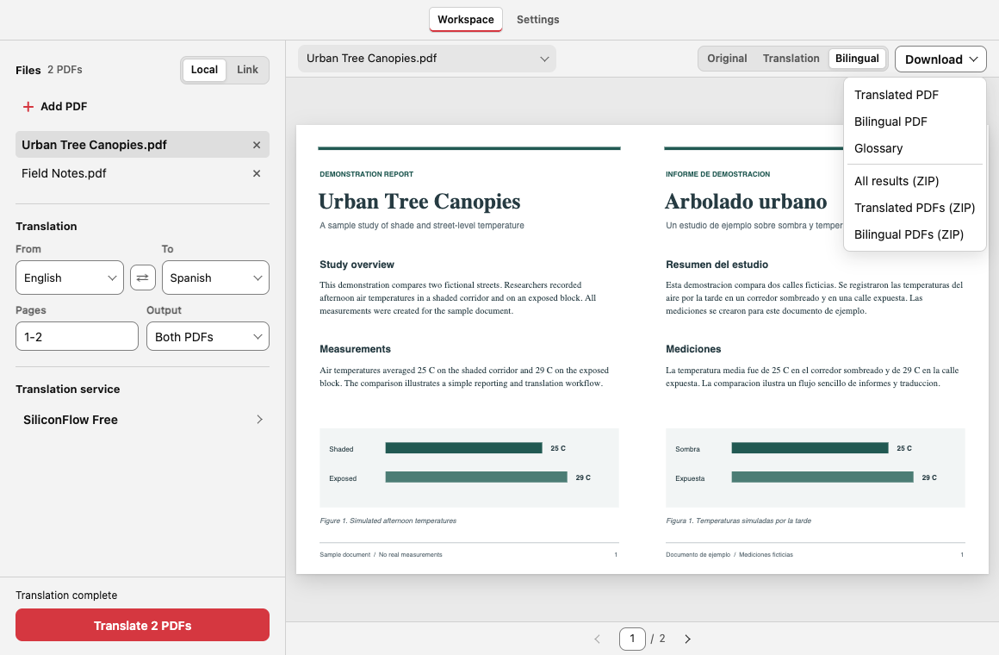
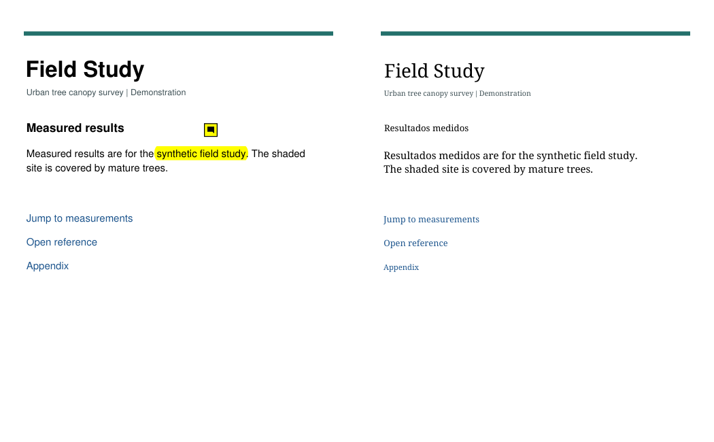
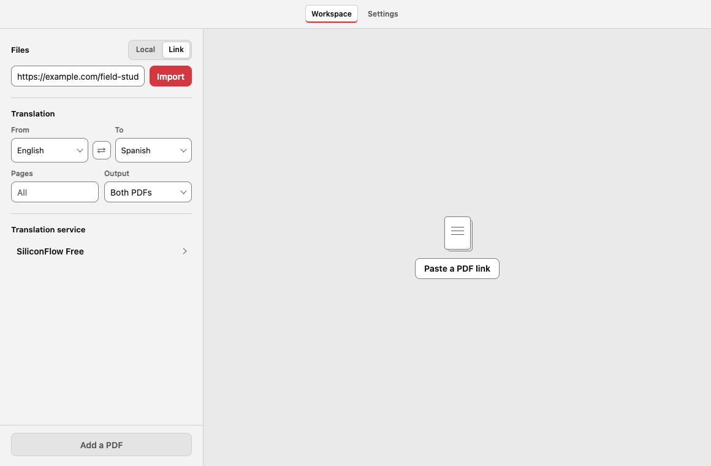
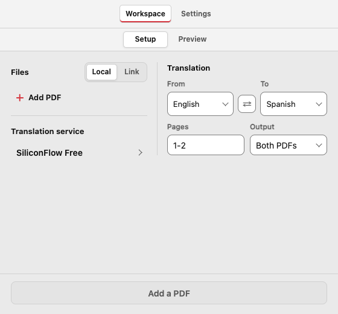
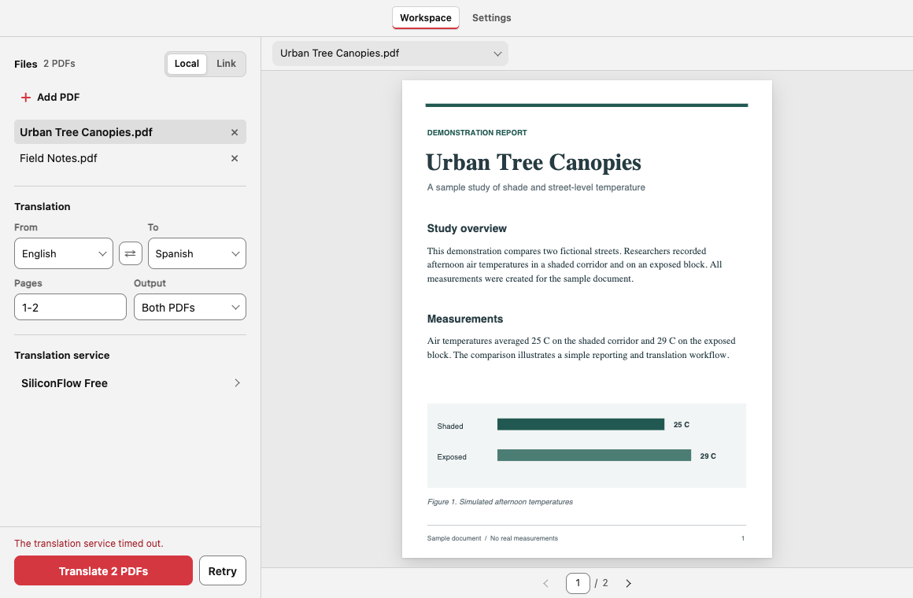
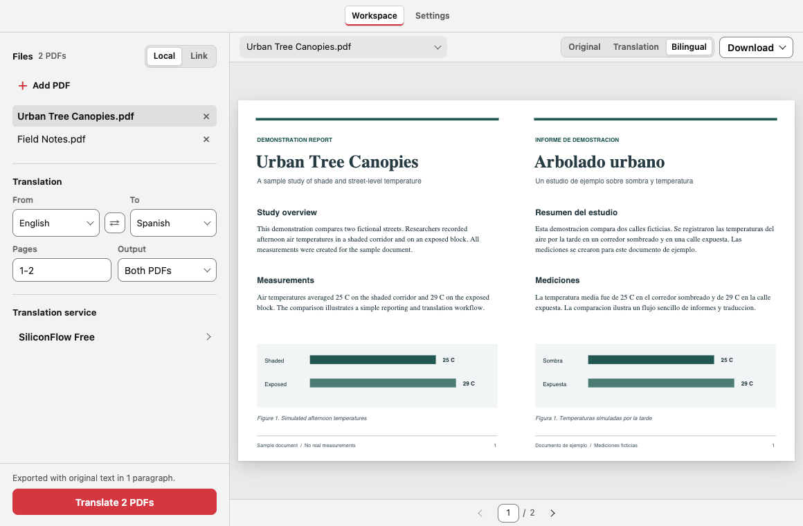
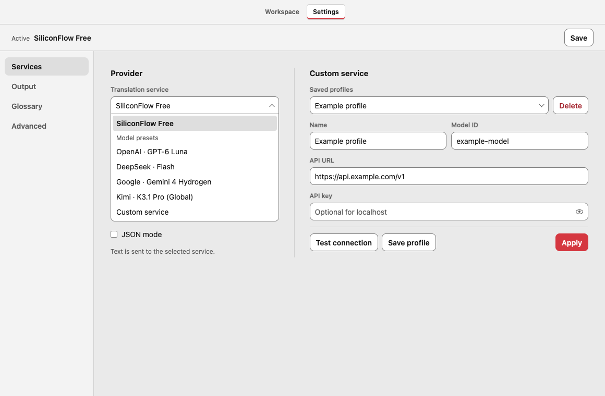

# PDF Translator for macOS

PDF Translator is a native macOS workbench for translating searchable PDFs. Import local files or a PDF link, select the pages you want, and review the original, translation, and bilingual export in the same window. The app supports the SiliconFlow Free gateway and OpenAI-compatible endpoints, including local services.

## Download

Download the Apple Silicon ZIP from [Latest release](https://github.com/FlaxXTT/PDF-Translator-macOS/releases/latest), unzip it, and open **PDF Translator.app**. The packaged ONNX Runtime requires macOS 14 or later. The build uses an ad-hoc signature and is distributed without Apple notarization.

A blank **Pages** field selects the whole document. Enter `2,5,9-12` to select individual pages and ranges. The **Settings** view contains the provider, output, and glossary controls.

PDF layout and rendering run locally. Cloud translation sends extracted text to the selected service. Image-only PDFs need a searchable text layer. Side-by-side exports preserve bookmarks, internal links, hyperlinks, and annotations on the original panel. Open the exported PDF in a PDF reader to follow its links and view comments. If a page is excluded from the export, links to that page are inactive.

## See the app in action



The screenshots use sample PDFs and a local simulated translation service.

### Original links and annotations in bilingual exports



The original panel keeps the table-of-contents link, web reference, highlight, and comment. The translation occupies the other panel.

<details>
<summary>Import, page selection, and compact layout</summary>

| Workspace | Link import |
| --- | --- |
|  |  |

| Page selection | Compact layout |
| --- | --- |
|  |  |

</details>

<details>
<summary>Translation progress, retry, and export feedback</summary>

| Translation progress | Retry |
| --- | --- |
|  |  |

**Export feedback**



</details>

<details>
<summary>Provider, output, glossary, and advanced settings</summary>

| Provider selection | Provider preset |
| --- | --- |
|  |  |

| Output settings | Glossary |
| --- | --- |
|  |  |

**Advanced**


</details>

## Build

Build on Apple Silicon macOS with a current stable Rust toolchain and the macOS SDK.

```sh
cargo build --release --locked
```

To assemble the same release variant, extract a matching GitHub release ZIP and use its `Contents/Resources` directory as the runtime input. The packaging script verifies the runtime files against the SHA-256 manifest, rebuilds the executable, stages the application, and creates a signed ZIP and checksum.

```sh
./packaging/build-app.sh '/path/to/PDF Translator.app/Contents/Resources' ./dist
```

To run the unbundled executable during development, supply that same runtime resource directory.

```sh
HERMENEUEIN_RESOURCES='/path/to/PDF Translator.app/Contents/Resources' \
HERMENEUEIN_DATA="$(mktemp -d)" \
  ./target/release/hermeneuein
```

## Credits and license

Maintained by [FlaxXTT](https://github.com/FlaxXTT). The original prototype used [PDFMathTranslate-next 2.10.2](https://github.com/PDFMathTranslate-next/PDFMathTranslate-next/releases/tag/v2.10.2). PDF handling incorporates modified native components from [BabelDOC 0.7.1](https://github.com/funstory-ai/BabelDOC/tree/d922e2b0c5a353bde8731921eb442c07ae75849d). The application uses AppKit, WebKit, PDF.js, DocLayout-YOLO, ONNX Runtime, and open fonts.

The application source is available under the [GNU AGPL v3](LICENSE). Vendored sources, modification notices, and third-party asset terms are included. Release tags identify the corresponding application source. [Upstream notices](upstream-notices) · [Vendored BabelDOC changes](upstream-notices/BABELDOC-MODIFICATIONS.md)
