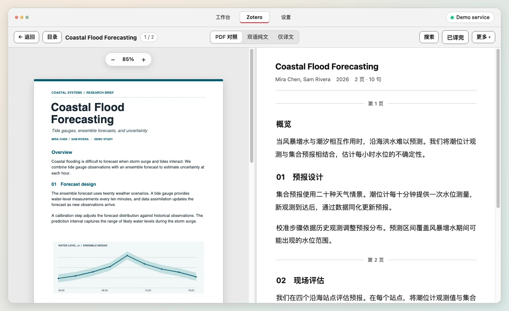
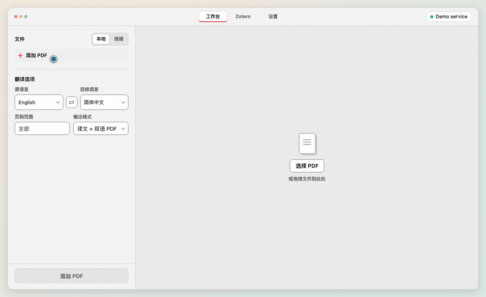
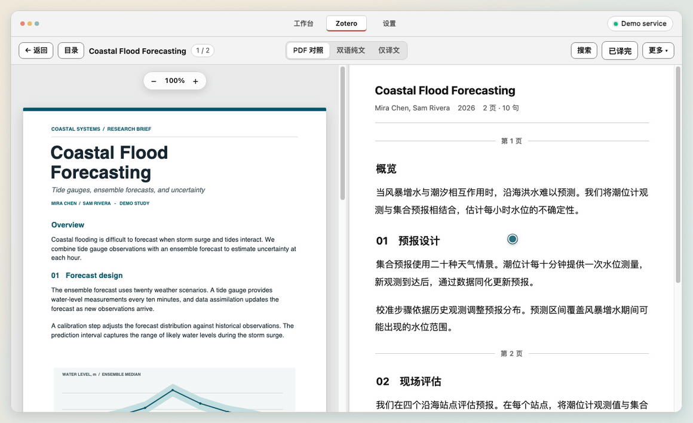
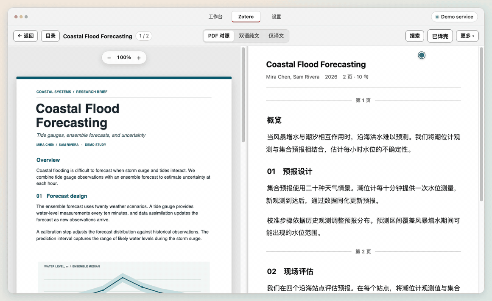

<h1 align="center">PDF Translator</h1>
<p align="center">Translate PDFs and read them side by side.</p>

<p align="center">
  <a href="https://github.com/FlaxXTT/PDF-Translator-macOS/releases/latest"></a>
  <br><sub>Apple silicon · macOS 14+</sub>
</p>

<p align="center"></p>

## Translate & export



## Read with Zotero



## Recover & export a glossary



<sub>Demos use a sample PDF and a simulated translation service.</sub>

<details>
<summary>Requirements, build, and credits</summary>

Use searchable PDFs. Layout runs locally. Cloud translation sends extracted text to the selected provider. The app is distributed with an ad-hoc signature.

Build from the matching [release tag](https://github.com/FlaxXTT/PDF-Translator-macOS/tags) with stable Rust, the macOS SDK, and the release app’s runtime assets.

```sh
./packaging/build-app.sh '/path/to/PDF Translator.app/Contents/Resources' ./dist
```

[AGPL‑3.0](LICENSE) · [BabelDOC](https://github.com/funstory-ai/BabelDOC) · [PDFMathTranslate-next](https://github.com/PDFMathTranslate-next/PDFMathTranslate-next) · [Third-party notices](upstream-notices)

</details>
